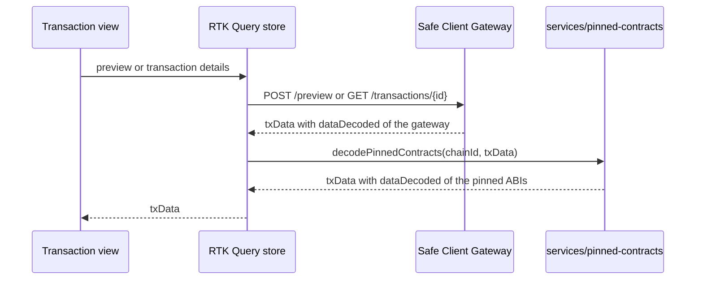
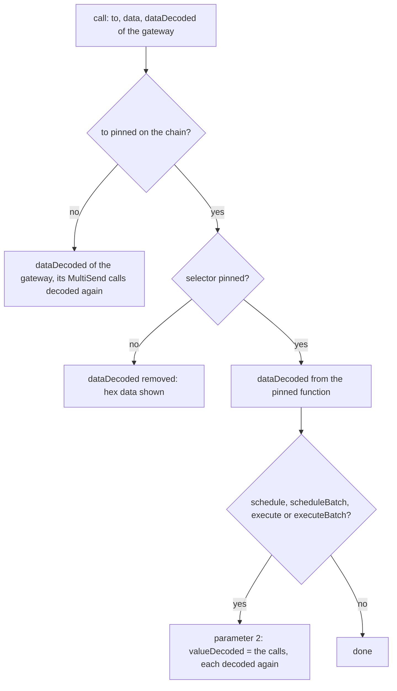
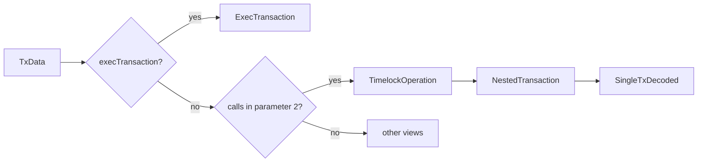

# Decoding calls to the SimpleX namespace contracts with pinned ABIs

## Problem

Signers see the calls of a Safe transaction as decoded by the Safe Client Gateway, which decodes with Safe's decoder service.

- The decoder service downloads the ABI of a contract only after a Safe transaction to that contract is executed. Until then, a call is shown as hex data, or decoded with the ABI of another contract that has a function with the same selector, and the web app does not show which.
- Nested `bytes` are decoded only for MultiSend and Safe `execTransaction`. The call that an OpenZeppelin `TimelockController` schedules or executes is shown as hex data.

The SimpleX namespace contracts on Ethereum are administered by Safes, and the admin Safe acts through a `TimelockController`.

## Decisions

- The ABIs of the namespace contracts are part of the build: `apps/web/src/services/pinned-contracts/contracts.json`.
- Each pinned contract is listed by name and address. Its functions are the state-changing functions of the ABI verified on Sourcify, as human-readable signatures. For a proxy, the functions of the proxy and of its implementation are listed.
- A proxy that Sourcify does not resolve, such as each `TransparentUpgradeableProxy` of the `.simplex` v2 deployment (tag `simplex-mainnet-v2`), lists its implementations in `implementations`; its functions are those of the listed implementations, which Sourcify verifies. The proxy's own ABI is left out: a transparent proxy answers only its `ProxyAdmin`, which is pinned with its own functions.
- `apps/web/scripts/pinned-contracts.mjs` regenerates the functions of every listed contract. A new contract is listed by its name and address, then the script is run. An upgraded implementation is pinned by running the script, or, for a proxy with `implementations`, by listing the new implementation there first.
- The v2 implementations of `SimplexController`, `SimplexNamePolicy` and `SimplexSponsor` deployed by run 1 are not verified on Sourcify; these proxies are pinned with the implementations of simplex-network/ens-contracts#49, which are. A selector of a run 1 implementation that #49 removed is shown as hex data. `BaseRegistrarImplementation`'s proxy is pinned once its implementation is verified.
- The decoding of a call to a pinned contract replaces the decoding of the gateway. A call to a pinned contract with a selector that is not pinned is shown as hex data.
- The calls inside `schedule`, `scheduleBatch`, `execute` and `executeBatch` of a pinned timelock are decoded, recursively, and listed in the "Nested transaction" card, expanded.
- The calls inside a MultiSend are decoded with the pinned ABIs when their target is pinned.
- Calls to contracts that are not pinned keep the decoding of the gateway.

## Mechanics

The responses of the transaction preview and of the transaction details are transformed where they enter the store. The decoding module and its ABIs are loaded on the first transformed response.

`decodePinnedContracts` decides per call:

The transaction views render a timelock call with its calls as a nested transaction, where they render a Safe `execTransaction`:

## Acceptance

- A call to a pinned contract is shown decoded with the pinned ABI in the review of a new transaction and in the details of a queued transaction.
- A `schedule` or `scheduleBatch` call to a pinned timelock shows each scheduled call decoded.
- A MultiSend call to pinned contracts shows each call decoded with the pinned ABIs.
- Unit tests cover each case above, the unpinned selector and the unpinned contract.
