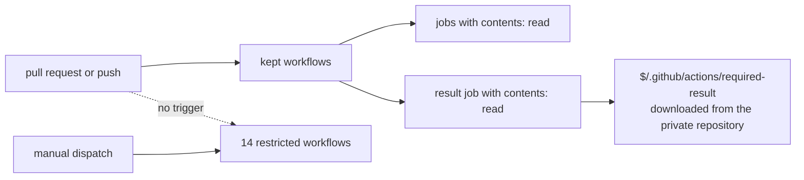

# CI of the fork

## Problem

In this private fork, every pull request ends with failed checks that the change under review does not cause.

## Decisions

- Restricted to `workflow_dispatch`, because each requires the infrastructure, secrets or same-repository branches of `safe-global`:
  - `claude-code-review.yml`
  - `mobile-dev-release.yml`
  - `mobile-e2e.yml`
  - `store-codegen-drift.yml`
  - `tx-builder-deploy.yml`
  - `web-argos-storybook.yml`
  - `web-deploy-dev.yml`
  - `web-deploy-dockerhub.yml`
  - `web-e2e-full-ondemand.yml`
  - `web-isolated-e2e-backend.yml`
  - `web-nextjs-bundle-analysis.yml`
  - `web-pw-full-ondemand.yml`
  - `web-pw-smoke.yml`
  - `web-tag-release.yml`
- Result jobs given `contents: read`:
  - `mobile-checks.yml`
  - `mobile-unit-tests.yml`
  - `package-utils-unit-tests.yml`
  - `tx-builder-checks.yml`
  - `web-checks.yml`
  - `web-tanstack-checks.yml`
  - `web-unit-tests.yml`
- Check jobs given `contents: read`:
  - `lint`, `prettier` and `type-check` of `tx-builder-checks.yml`
  - `test` of `package-utils-unit-tests.yml`
- In `web-unit-tests.yml`, `base-coverage` and `coverage-report` are skipped for pull requests from forks.
- Ported from `safe-global/safe-wallet-monorepo`:
  - #9621: web Jest in `Europe/Berlin`
  - #9582: longer web Jest timeouts on CI
- Unchanged:
  - workflow files, all kept
  - workflows that pass
  - manual-only workflows
  - `actions.lock`

## Mechanics

| Part                               | Change                                                                       |
| ---------------------------------- | ---------------------------------------------------------------------------- |
| `on:` of the 14 workflows          | every trigger except `workflow_dispatch` removed                             |
| `result` job of the 7 workflows    | `permissions: {}` replaced by `contents: read`                               |
| the 4 check jobs                   | `contents: read` added to `permissions`                                      |
| `base-coverage`, `coverage-report` | `github.event.pull_request.head.repo.full_name == github.repository` in `if` |
| `apps/web/package.json`            | `test`: `TZ=Europe/Berlin`                                                   |
| `apps/web/jest.setup.js`           | `process.env.TZ = 'UTC'` removed; `asyncUtilTimeout` 3 s on CI               |
| `apps/web/jest.config.cjs`         | `testTimeout` 15 s on CI                                                     |

## Acceptance

- On the pull request of this branch, every workflow started automatically concludes `success` or `skipped`.
