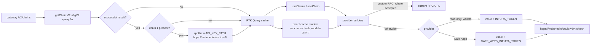

# Mainnet reads through Infura

## Problem

On GitHub Pages, mainnet reads through the RPC of the production gateway's chain list fail: the CORS pre-flight of that RPC, `https://rpc.safe.global/1/`, is answered for the Pages origin with 403 and without `Access-Control-Allow-Origin`.

Readers of the mainnet `rpcUri`:

- the read-only provider (`useInitWeb3`) and every reader of it
- the ENS hub provider
- the sanctions check
- the module guard
- Safe creation
- policies
- the Safe scope provider
- the wallet RPC of hardware wallets and the private-key wallet
- the RPC calls of Safe Apps
- the RPC settings placeholder
- RPC error attribution

## Decisions

- The mainnet `rpcUri` is replaced in the result of the `getChainsConfigV2` query function.
- Replacement:
  - authentication: `API_KEY_PATH`
  - value: `https://mainnet.infura.io/v3/`
- Condition:
  - `IS_PRODUCTION` is true
  - `INFURA_TOKEN` is non-empty
- Set up: once, in `apps/web/src/pages/_app.tsx`, before its store is created; the same module is evaluated by the TanStack runtime through `apps/web-tanstack/src/routes/__root.tsx`.
- Unchanged:
  - other chains
  - the mobile app
  - builds with `IS_PRODUCTION` false, including the isolated end-to-end stack
  - precedence of the user's custom RPC
- Changed for users, on mainnet:
  - the RPC of hardware wallets and the private-key wallet is Infura with `INFURA_TOKEN`
  - the RPC calls of Safe Apps are sent to Infura with `SAFE_APPS_INFURA_TOKEN`, which is `INFURA_TOKEN` when unset
  - the placeholder of Settings → Environment variables → RPC provider is `https://mainnet.infura.io/v3/`
  - RPC errors of the read-only provider are attributed to `infura`

## Mechanics

| Part                                           | Change                                                                                |
| ---------------------------------------------- | ------------------------------------------------------------------------------------- |
| `apps/web/src/store/api/gateway/mainnetRpc.ts` | the `queryFn` of `getChainsConfigV2` is wrapped by `replaceMainnetRpc()`              |
| wrapper                                        | in a successful result, the `rpcUri` of chain `1` is set by `chainsAdapter.updateOne` |
| `apps/web/src/pages/_app.tsx`                  | `if (IS_PRODUCTION && INFURA_TOKEN) replaceMainnetRpc()` before `makeStore()`         |

## Acceptance

In a production build with a token:

- The `rpcUri` of chain `1` is `API_KEY_PATH` `https://mainnet.infura.io/v3/`.
- The `rpcUri` of chain `137` is unchanged.
- The `eth_call` of the sanctions check is sent to `https://mainnet.infura.io/v3/<token>`.
- A failed chain list is returned unchanged.

Evidence:

- At `26dc12bf`, the first form of the chain `1` test fails on the code of `main`: https://github.com/simplexchat/safe-wallet-monorepo/actions/runs/44273529603
- Static exports served from an origin outside Safe's domains: `main` has 12 of 12 mainnet RPC requests blocked; the branch has 20 of 20 sent to `mainnet.infura.io` with HTTP 200.

Untested:

- the line in `_app.tsx`
- the `throw` in `mainnetRpc.ts`
- TanStack coverage through the import of `@/pages/_app` in `__root.tsx`
