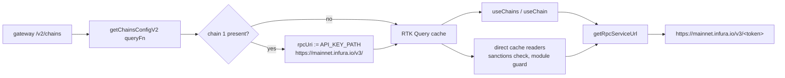

# Mainnet reads through Infura

## Problem

On GitHub Pages, every mainnet read of the app fails. In the production gateway's chain list, the mainnet `rpcUri` is `https://rpc.safe.global/1/`, without authentication. The CORS pre-flight of that host is answered:

- from `https://laughing-carnival-w9n8mnm.pages.github.io`: 403
- from `https://app.safe.global`: 204
- from `http://localhost:3000`: 204

Readers of this value:

- the read-only provider: ENS names, RPC balance and nonce reads
- the sanctions check
- Safe creation
- the mainnet chain of hardware wallets and the private-key wallet

## Decisions

- The mainnet `rpcUri` is replaced where the chain list enters the web store.
- Replacement value: `API_KEY_PATH`, `https://mainnet.infura.io/v3/`.
- Condition: the build has `NEXT_PUBLIC_INFURA_TOKEN`.
- Unchanged:
  - other chains
  - the mobile app
  - precedence of the user's custom RPC
- Changed for users: the mainnet placeholder of Settings → Environment variables → RPC provider shows `https://mainnet.infura.io/v3/`.

## Mechanics

| Part                                           | Change                                                                      |
| ---------------------------------------------- | --------------------------------------------------------------------------- |
| `apps/web/src/store/api/gateway/mainnetRpc.ts` | `replaceMainnetRpc()` wraps the `queryFn` of `getChainsConfigV2`            |
| wrapper                                        | `chainsAdapter.updateOne` sets `rpcUri` of chain `1` in a successful result |
| `apps/web/src/store/index.ts`                  | `if (INFURA_TOKEN) replaceMainnetRpc()`, once at module load                |

## Acceptance

- With a token, `useChain('1').rpcUri` is `API_KEY_PATH` `https://mainnet.infura.io/v3/`.
- With a token, chain `137` keeps the gateway's `rpcUri`.
- Without a token, chain `1` keeps the gateway's `rpcUri`.
- The first test fails on `main` and passes on the branch.
