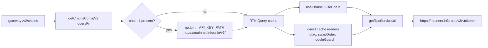

# Mainnet reads through Infura

## Problem

On a host other than Safe's own, such as GitHub Pages, every mainnet read of the app fails. The gateway's chain list sets the mainnet `rpcUri` to `https://rpc.safe.global/1/` without authentication, and that host answers browser requests only from Safe's origins and `localhost`. ENS names, the sanctions check, Safe creation and the RPC of hardware wallets all use this value.

## Decisions

- The mainnet `rpcUri` is replaced where the chain list enters the web store.
- Replacement value: `API_KEY_PATH`, `https://mainnet.infura.io/v3/`.
- Condition: the build has `NEXT_PUBLIC_INFURA_TOKEN`.
- Unchanged: other chains, the mobile app, the user's custom RPC setting.

## Mechanics

| Part                                           | Change                                                                  |
| ---------------------------------------------- | ----------------------------------------------------------------------- |
| `apps/web/src/store/api/gateway/mainnetRpc.ts` | `readMainnetThroughInfura()` wraps the `queryFn` of `getChainsConfigV2` |
| wrapper                                        | sets `rpcUri` of chain `1` in a successful result                       |
| `apps/web/src/store/index.ts`                  | `if (INFURA_TOKEN) readMainnetThroughInfura()`, once at module load     |

`transformResponse` is not used: RTK Query applies it to `query` endpoints only, and `getChainsConfigV2` is a `queryFn` endpoint.

## Acceptance

- With a token, `useChain('1').rpcUri` is `API_KEY_PATH` `https://mainnet.infura.io/v3/`.
- Chain `137` keeps the gateway's `rpcUri`.
- The test fails on `main` and passes on the branch.
