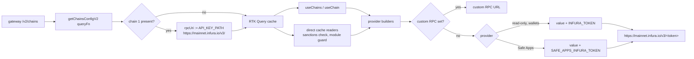

# Mainnet reads through Infura

## Problem

On GitHub Pages, mainnet reads through the RPC of the production gateway's chain list fail: that RPC, `https://rpc.safe.global/1/`, refuses the Pages origin.

Readers of the mainnet `rpcUri`:

- the read-only provider: ENS names, RPC balance and nonce reads
- the ENS hub provider
- the sanctions check
- the module guard
- Safe creation
- policies
- the Safe scope provider
- the mainnet chain of hardware wallets and the private-key wallet
- the RPC calls of Safe Apps
- the RPC settings placeholder
- RPC error attribution

## Decisions

- The mainnet `rpcUri` is replaced in the result of the `getChainsConfigV2` query function.
- Replacement:
  - authentication: `API_KEY_PATH`
  - value: `https://mainnet.infura.io/v3/`
- Condition: `INFURA_TOKEN` is non-empty.
- Set up: once, in `apps/web/src/pages/_app.tsx`, before its store is created; the TanStack runtime evaluates the same module through `apps/web-tanstack/src/routes/__root.tsx`.
- Unchanged:
  - other chains
  - the mobile app
  - precedence of the user's custom RPC
- Changed for users:
  - the RPC calls of Safe Apps on mainnet go to Infura with `SAFE_APPS_INFURA_TOKEN`, which is `INFURA_TOKEN` when unset
  - the mainnet placeholder of Settings → Environment variables → RPC provider is `https://mainnet.infura.io/v3/`
  - RPC errors of the mainnet read-only provider are attributed to `infura`

## Mechanics

| Part                                           | Change                                                                      |
| ---------------------------------------------- | --------------------------------------------------------------------------- |
| `apps/web/src/store/api/gateway/mainnetRpc.ts` | `replaceMainnetRpc()` wraps the `queryFn` of `getChainsConfigV2`            |
| wrapper                                        | `chainsAdapter.updateOne` sets `rpcUri` of chain `1` in a successful result |
| `apps/web/src/pages/_app.tsx`                  | `if (INFURA_TOKEN) replaceMainnetRpc()` before `makeStore()`                |

## Acceptance

- `useChain('1').rpcUri` is `API_KEY_PATH` `https://mainnet.infura.io/v3/`.
- Chain `137` keeps the gateway's `rpcUri`.
- A sanctions check sends its `eth_call` to `https://mainnet.infura.io/v3/<token>`.
- A failed chain list is returned unchanged.
- At `26dc12bf`, the test of chain `1`'s `rpcUri` fails on the code of `main`.
- Untested: the line in `_app.tsx`.
